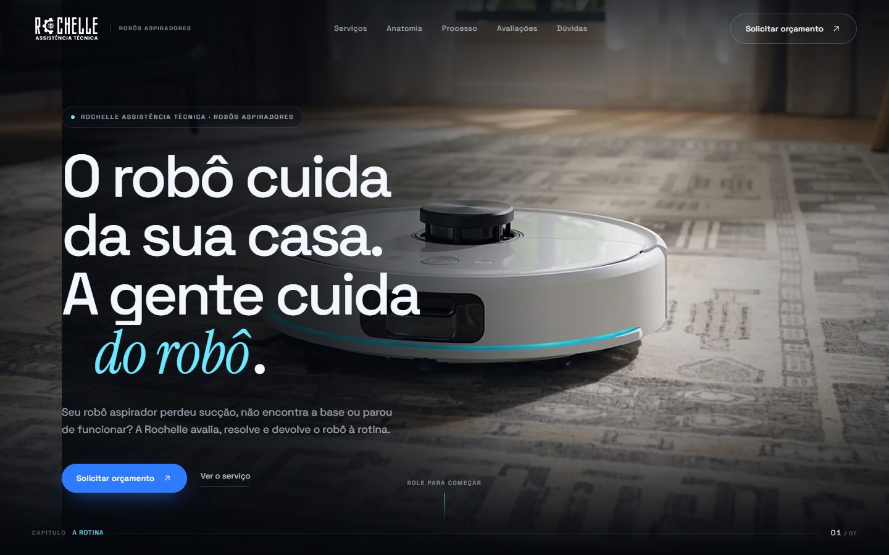
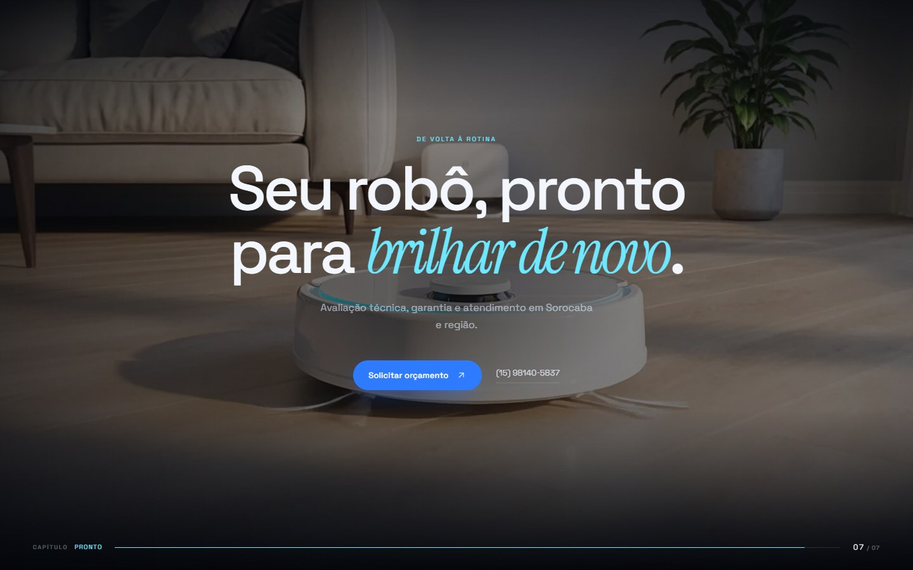
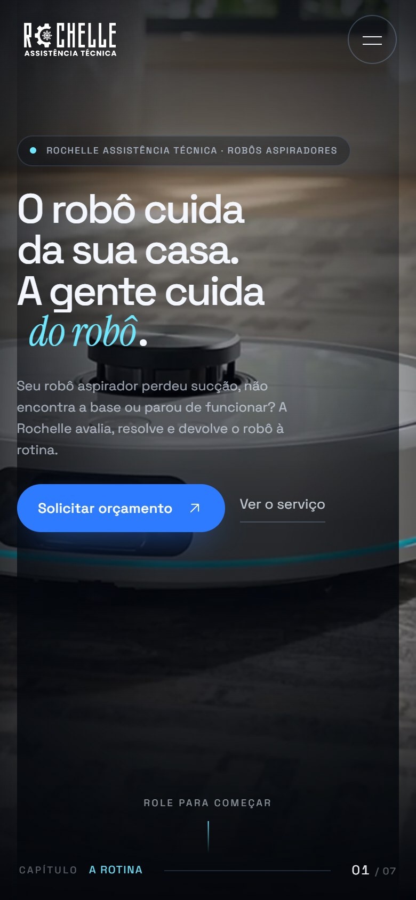

# 🤖 Rochelle Assistência Técnica

### Robôs aspiradores cuidados com método, precisão e cinema.

<p align="center">
  <a href="https://allandevbrazil.github.io/rochele-assistencia-tecnica-robos/">
    
  </a>
  
  
  
  
</p>

<p align="center">
  <strong>Uma landing page cinematográfica para uma assistência técnica especializada em robôs aspiradores.</strong><br>
  Hero com filme AI frame a frame, narrativa conduzida pelo scroll, design editorial e foco total em conversão pelo WhatsApp.
</p>

---

## ✨ Sobre o projeto

A **Rochelle Assistência Técnica** atua em Sorocaba e região com manutenção especializada em robôs aspiradores. O site foi criado para traduzir esse cuidado em uma experiência digital premium: imagem forte, narrativa clara e contato direto.

O projeto não é apenas uma página institucional. É uma pequena experiência interativa:

- 🎬 Um **filme AI em 218 frames** controlado pela rolagem;
- 🧠 Copywriting focado nos problemas reais do robô;
- 🛠️ Seções que explicam o serviço, o processo e a anatomia do equipamento;
- 💬 CTAs objetivos para **Solicitar orçamento** pelo WhatsApp;
- 📱 Layout responsivo, acessível e otimizado para carregamento.

### 🌐 Demo

**GitHub Pages:** [allandevbrazil.github.io/rochele-assistencia-tecnica-robos](https://allandevbrazil.github.io/rochele-assistencia-tecnica-robos/)

---

## 🎬 O hero cinematográfico

O grande diferencial do projeto é o hero. Em vez de um vídeo pesado ou uma cena 3D genérica, a narrativa foi construída como uma **sequência de frames WebP** desenhada em canvas e sincronizada com o scroll.

### 🧭 A história em 7 capítulos

| # | Capítulo | O que acontece |
|---|----------|----------------|
| 01 | **A rotina** | O robô limpa a casa em uma cena calma e luminosa. |
| 02 | **A sujeira** | O acúmulo invisível aparece em close. |
| 03 | **A falha** | O robô trava, se perde e deixa de dar conta. |
| 04 | **O diagnóstico** | A cena muda para a bancada e o olhar técnico. |
| 05 | **Por dentro** | Peças, motor, sensores e o que ninguém vê. |
| 06 | **A limpeza** | O cuidado interno que devolve performance. |
| 07 | **Pronto** | O robô volta a funcionar e a casa volta à rotina. |

### ⚙️ Como funciona tecnicamente

```text
assets/hero/manifest.js
        │
        ▼
window.__HERO_FRAMES__ = { count, prefix, pad, ext }
        │
        ▼
js/film.js
  ├─ pré-carrega os primeiros frames antes de liberar a página
  ├─ prioriza keyframes (a cada 4 frames)
  ├─ baixa o restante com concorrência controlada
  ├─ desenha no canvas com cobertura responsiva
  └─ dispara o evento "heroready"
        │
        ▼
js/main.js
  ├─ ScrollTrigger cria a linha do tempo do hero
  ├─ capítulos, HUD e barra de progresso
  └─ overlays entram e saem no ritmo da narrativa
```

- 🖼️ **218 frames WebP** em `1600 × 900`;
- 🚀 pré-carga dos primeiros 40 frames para liberar a experiência;
- 🧠 carregamento em duas camadas: keyframes primeiro, resto depois;
- 📱 ajuste de foco do canvas para telas menores;
- 🎞️ fallback em imagem estática para `prefers-reduced-motion` e ausência de canvas;
- 🧩 fallback em HTML para navegadores sem JavaScript.

> O hero é uma experiência visual, mas não sequestra a navegação. Há link de pulo, fallback e respeito à preferência de movimento reduzido.

---

## 🧩 Arquitetura

O projeto é intencionalmente **vanilla**: HTML semântico, CSS autoral e JavaScript modular, com GSAP apenas onde a coreografia precisa de precisão.

```text
rochele-assistencia-tecnica-robos/
├── index.html                  # Estrutura, SEO, JSON-LD e todas as seções
├── css/
│   └── style.css               # Design system, layout, animações e responsividade
├── js/
│   ├── film.js                 # Preload + renderização do filme no canvas
│   └── main.js                 # Loader, nav, hero, reveal, processo, FAQ, etc.
├── vendor/
│   ├── gsap.min.js
│   ├── ScrollTrigger.min.js
│   └── lenis.min.js
├── assets/
│   ├── brand/                  # Logos e marca
│   ├── fonts/                  # Space Grotesk + Instrument Serif
│   ├── hero/                   # 218 frames + manifest.js
│   ├── img/                    # Imagens otimizadas do site
│   └── source/
│       ├── film/               # Clipes AI de origem (7 MP4)
│       └── stock/              # Matérias-primas visuais do projeto
├── docs/
│   └── screenshots/            # Imagens de apresentação
├── .nojekyll                   # Publicação estável no GitHub Pages
└── README.md
```

### 🧱 Camadas da aplicação

| Camada | Arquivo | Responsabilidade |
|--------|---------|------------------|
| **Estrutura** | `index.html` | Semântica, conteúdo, acessibilidade, metadata, JSON-LD |
| **Visual** | `css/style.css` | Tokens, grid, tipografia, temas, motion, breakpoints |
| **Filme** | `js/film.js` | Preload, canvas, DPR, foco mobile, fallback |
| **Interação** | `js/main.js` | Lenis, nav, hero timeline, reveals, pin horizontal, FAQ, carrossel |
| **Bibliotecas** | `vendor/` | GSAP + ScrollTrigger + Lenis |
| **Conteúdo visual** | `assets/` | Frames, fotos, fontes, marca e clipes de origem |

### 🎨 Design system

| Token | Valor | Uso |
|-------|-------|-----|
| Ink | `#05070c` | Fundo escuro principal |
| Paper | `#f4f6f9` | Seções claras |
| Blue | `#1b54b8` | Ação e identidade |
| Cyan | `#6ee7ff` | Destaque e detalhes técnicos |
| Serif | Instrument Serif Italic | Ênfase editorial |
| Sans | Space Grotesk | Interface e leitura |

O layout alterna **ink → paper → ink**, usa bordas arredondadas amplas, grão sutil, tipografia grande e microinterações. O cursor customizado e o loader completam a sensação de produto cuidado.

---

## 🛠️ Stack

| Tecnologia | Por que está aqui |
|------------|-------------------|
| **HTML5** | Estrutura semântica e acessível |
| **CSS3** | Layout responsivo, custom properties, grid, motion |
| **JavaScript** | Lógica do filme, interações e estados |
| **GSAP** | Timeline do hero, reveals, pin do processo |
| **ScrollTrigger** | Sincronização precisa com o scroll |
| **Lenis** | Rolagem suave e consistente |
| **Canvas 2D** | Renderização leve da sequência de frames |
| **Python HTTP Server** | Preview local simples |
| **GitHub Pages** | Deploy estático gratuito |

Sem framework, sem build step e sem dependência de servidor. O site abre como arquivo estático e também roda em qualquer CDN.

---

## 📐 Seções da página

1. **Hero cinematográfico** — filme scroll-driven + CTA de orçamento.
2. **Manifesto** — posicionamento e autoridade.
3. **Rotina** — o benefício de um robô bem cuidado.
4. **Serviços** — manutenção, sensores, escovas/baterias e filtros.
5. **Bastidores** — registros reais da bancada.
6. **Anatomia** — hotspots interativos com os pontos de manutenção.
7. **Processo** — cinco etapas em um painel horizontal.
8. **Sintomas** — cards com diagnóstico rápido.
9. **Depoimentos** — avaliações reais do Google.
10. **Atendimento** — endereço, mapa estilizado e contato.
11. **Dúvidas** — FAQ em acordeão.
12. **Contato** — CTA final e canais diretos.

---

## 🚀 Rodando localmente

Como o projeto não tem build step, basta servir a pasta raiz:

```bash
cd rochele-assistencia-tecnica-robos
python -m http.server 4173
```

Depois abra:

```text
http://127.0.0.1:4173
```

> Também funciona com `npx serve .`, Live Server do VS Code ou qualquer servidor estático.

---

## 🌐 Deploy no GitHub Pages

O deploy é feito diretamente da branch **`main`**, na raiz do repositório.

```text
Settings → Pages → Build and deployment
Source: Deploy from a branch
Branch: main
Folder: / (root)
```

O arquivo `.nojekyll` evita processamento desnecessário pelo Jekyll.

**URL publicada:** [https://allandevbrazil.github.io/rochele-assistencia-tecnica-robos/](https://allandevbrazil.github.io/rochele-assistencia-tecnica-robos/)

---

## ⚡ Performance & acessibilidade

- 🎞️ O hero usa **218 frames leves em WebP** em vez de um vídeo contínuo;
- 🚦 pré-carga limitada aos frames essenciais para o primeiro capítulo;
- 🖼️ imagens abaixo do hero com `loading="lazy"` e dimensões declaradas;
- 📐 canvas com cobertura correta em desktop e mobile;
- ♿ skip link, landmarks, `aria-*`, foco visível e botões reais;
- 🧘 `prefers-reduced-motion` desliga o filme e entrega o poster estático;
- 🧩 fallback para ambientes sem JavaScript;
- 🔍 títulos, descrição, Open Graph e JSON-LD `LocalBusiness`.

### 📦 Peso do projeto

- Hero: **~12,5 MB** de frames;
- Site completo (com fontes, imagens e vídeos-fonte): **~55 MB**;
- Sem etapa de build, sem `node_modules`, sem dependências de servidor.

---

## 🧭 Diretrizes de conteúdo

O site foi ajustado para refletir o atendimento real da Rochelle:

- 💬 **Orçamento definido caso a caso**, pelo WhatsApp;
- 🧪 **Avaliação técnica** feita pela Rochelle, com orçamento enviado o mais rápido possível pelo WhatsApp;
- 🛠️ **Garantia** mencionada de forma genérica, sem prazo fechado no site;
- 🚫 Sem nomes de marcas específicas na comunicação;
- 🚫 Sem promessa de atendimento no local ou de transporte incluso;
- 📍 Atendimento em Sorocaba e região.

Essas decisões mantêm a comunicação flexível e alinhada ao que é combinado diretamente com cada cliente.

---

## 📸 Preview

<p align="center">
  
</p>

<p align="center">
  
</p>

<p align="center">
  
</p>

---

## 📍 Contato

**Rochelle Assistência Técnica**  
R. João Soler Sanches, 37 · Jardim Natália  
Sorocaba – SP · CEP 18103-678  
📞 (15) 98140-5837  
💬 WhatsApp disponível no site

---

## 👨‍💻 Créditos

**Design & desenvolvimento:** [SELEGA](https://allandevbrazil.github.io/allandevbrazil_portfolio/)  
**Fotografia e registros de bancada:** acervo Rochelle Assistência Técnica  
**Filme AI:** frames gerados a partir de clipes produzidos para o projeto

<p align="center">
  <strong>O robô cuida da sua casa. A gente cuida do robô. 🤖✨</strong>
</p>

<p align="center">
  © 2026 Rochelle Assistência Técnica. Todos os direitos reservados.
</p>
